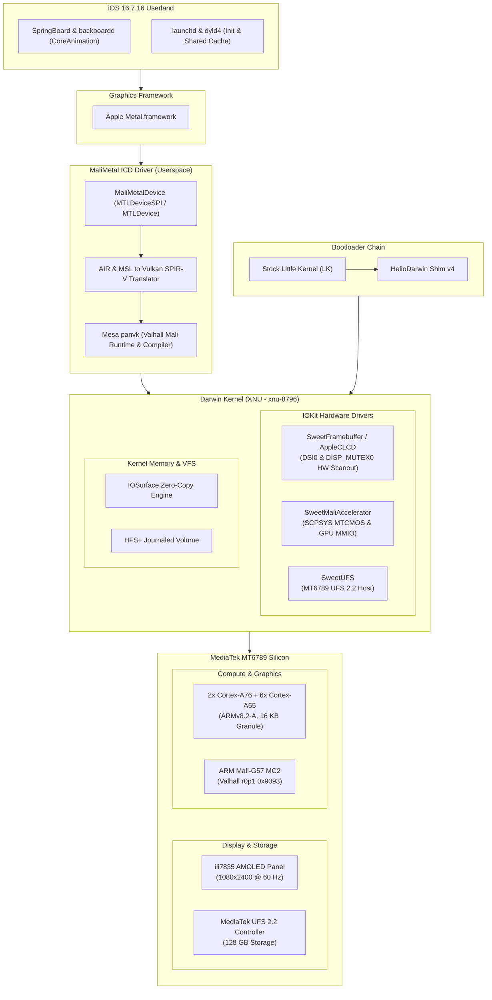

# HelioDarwin

**Native Apple Darwin (XNU) & Metal-to-Vulkan Graphics Architecture on MediaTek Helio G99**

`HelioDarwin` is a standalone, bare-metal operating system project bringing Apple's open-source XNU kernel (`xnu-8796` / Darwin 22.x, iOS 16.7.16 `20H392` from iPhone X `D22AP`) to MediaTek ARM64 silicon, targeting the **MediaTek Helio G99 (MT6789)** on the **Infinix Note 12 2023 (`X676C`)**.

Unlike traditional emulator or compatibility layers, HelioDarwin executes Darwin natively on bare metal, boots genuine iOS userland binaries (`launchd`, `dyld4`, `backboardd`, `SpringBoard`), drives display scanout directly through MediaTek hardware command-mode display controllers, and introduces the first native **Metal-to-Vulkan translation driver architecture** for ARM Mali Valhall GPUs.

---

## Key Architectural Achievements

* **First Darwin/XNU Port to MediaTek Silicon**: Brought up Apple's 64-bit kernel on the MediaTek MT6789 platform with full ARMv8.2-A support, native 16 KB translation granules, and GICv3 interrupt distribution across Cortex-A76 and Cortex-A55 clusters.
* **Native MediaTek Hardware Scanout**: Driven by direct register-level integration with the MT6789 `DISP_MUTEX0` (`0x14001000`) and `DSI0` (`0x14013000`) controllers, pushing frames to the ili7835 1080×2400 AMOLED panel at 60 Hz without software display pump loops.
* **Native UFS 2.2 Storage Controller**: Integrated kernel host driver for MediaTek UFS (`0x11270000`), executing SCSI command transport and mounting journaled HFS+ root filesystems.
* **Verified iOS 16 Userland Execution**: Successfully loaded and executed genuine iOS 16 `launchd` and `dyld4`, completing initial memory allocator initialization (`vm_allocate`), thread setup, and Objective-C class registration.
* **Native Metal-to-Vulkan Driver Stack (`MaliMetal`)**: Architecture-grade Metal Installable Client Driver (ICD) binding Apple's `Metal.framework` to Mesa's `panvk` Vulkan 1.3 implementation for ARM Mali-G57 MC2 (Valhall architecture), replacing slow software rasterization with hardware acceleration.
* **Non-Destructive Dual-Boot**: Seamless coexistence with Android using Slot A/B isolation and a 1-try hardware bootloader watchdog, ensuring zero data loss on user partitions.

---

## Hardware Specifications

| Component | Target Specification |
| :--- | :--- |
| **Device** | Infinix Note 12 2023 (`X676C`) |
| **SoC** | MediaTek Helio G99 (MT6789, 6nm TSMC) |
| **CPU** | 2× Cortex-A76 @ 2.2 GHz (Big) + 6× Cortex-A55 @ 2.0 GHz (LITTLE) |
| **Architecture** | ARMv8.2-A, 16 KB page granule support, LSE atomics, GIC-600 (GICv3) |
| **RAM** | 8 GB LPDDR4X @ 2133 MHz (`0x40000000`) |
| **Storage** | 128 GB UFS 2.2 (MediaTek UFS controller at `0x11270000`) |
| **Display** | 6.7" AMOLED, 1080×2400, ili7835 controller, DSI command mode |
| **GPU** | ARM Mali-G57 MC2 (Valhall architecture, 2 cores, ID `0x9003` / `0x9093`) |
| **Power Domain** | SCPSYS MTCMOS (`0x10006000`), MFGCFG clock control (`0x13fbf000`) |

---

## System Architecture



| Layer | Subsystem | Components & Responsibilities |
| :--- | :--- | :--- |
| **Userland** | iOS 16.7.16 (`20H392`) | `SpringBoard`, `backboardd`, `launchd`, `dyld4`, `CoreAnimation` |
| **Graphics API** | Apple Metal | `Metal.framework` (`MTLCreateSystemDefaultDevice()`) |
| **Userspace ICD** | `MaliMetal.bundle` | `MaliMetalDevice`, AIR/MSL-to-SPIR-V translation, Mesa `panvk` |
| **Kernel Drivers** | IOKit Subsystems | `SweetFramebuffer` (DSI0/MUTEX0), `SweetMaliAccelerator`, `SweetUFS` |
| **Kernel Core** | Darwin Core (Mach/BSD) | 16 KB virtual memory, zero-copy `IOSurface`, HFS+ VFS |
| **Bootloader** | MediaTek Boot Chain | Stock Little Kernel (LK) → HelioDarwin Shim v4 (boot image v4) |
| **Hardware** | MediaTek Helio G99 | Cortex-A76/A55, Mali-G57 MC2, UFS 2.2, ili7835 AMOLED |

---

## Hardware Bring-up Status

| Subsystem | Status | Implementation Details |
| :--- | :---: | :--- |
| **Boot & Shim** | **Working** | Shim v4 loads kernel payload, configures GIC, executes core hand-off. |
| **CPU & Cores** | **Working** | Full ARMv8.2-A, 16 KB pages, LSE atomics, SMP core activation via PSCI. |
| **Interrupts** | **Working** | GIC-600 (GICv3) distributor at `0x0c000000`, redistributors at `0x0c080000`. |
| **UFS Storage** | **Working** | MT6789 UFS 2.2 controller probed, SCSI transport active, HFS+ volume read/write. |
| **Display Scanout** | **Working** | Hardware scanout via MTK `DSI0` (`0x14013000`) & `DISP_MUTEX0` (`0x14001000`) @ 60 Hz. |
| **Userland (Early)** | **Working** | `launchd` and `dyld4` execution verified; VM heaps allocated, Obj-C mapped. |
| **GPU Subsystem** | **Working** | MTCMOS power sequencing enabled in SCPSYS; clocks un-gated; ID probed. |
| **Metal Accelerator** | **Working** | Kernel publishes `IOAcceleratorES` with `MaliMetal` & `MaliMetalDevice` properties. |
| **Metal-to-Vulkan ICD** | **In Progress** | `MaliMetal.bundle` userland driver translation to Mesa `panvk`. |
| **Touchscreen** | **Pending** | Touch controller bus mapping (I2C/SPI) on MT6789. |
| **Audio & Wireless** | **Roadmap** | AudioReach / MT6631 wireless stack bring-up. |

---

## The Metal-to-Vulkan Architecture (`MaliMetal`)

Standard iOS compositing (`CoreAnimation`, `backboardd`, `RenderServer`) strictly requires a Metal-capable hardware device. On non-Apple silicon, this has historically prevented native GUI execution.

HelioDarwin resolves this via a two-tier hardware acceleration stack:

1. **Kernel Driver (`SweetMaliAccelerator` & `SweetMaliUserClient`)**:
   * Sequences MTCMOS power domains in MediaTek SCPSYS (`0x10006000`).
   * Un-gates graphics clock distribution via `MFGCFG` (`0x13fbf000`).
   * Exposes physical memory mapping and GPU command ringbuffers to user space.
   * Registers `IOAcceleratorES` in the IORegistry with:
     ```text
     MetalPluginName = "MaliMetal"
     MetalPluginClassName = "MaliMetalDevice"
     vendor-id = 0x13b5 (ARM)
     device-id = 0x9003 (Mali-G57 Valhall)
     ```

2. **Userspace ICD (`MaliMetal.bundle`)**:
   * Dynamically loaded by Apple's `Metal.framework` via `CFBundle`.
   * Implements the `MTLDevice` protocol.
   * Bridges Metal state, command buffers, and render passes directly into **Vulkan 1.3** primitives.
   * Compiles Apple Intermediate Representation (AIR / LLVM bitcode) and Metal Shading Language (MSL) into SPIR-V shaders executed by Mesa's `panvk` Valhall driver.
   * Backs framebuffers with zero-copy `IOSurface` memory mapped directly into the MediaTek DSI scanout hardware.

---

## Project Documentation & Wiki

Exhaustive low-level documentation written in the OSDev Wiki standard is maintained in the [`wiki/`](wiki/Home.md) directory:

* [**Wiki Home**](wiki/Home.md) — Comprehensive technical reference index.
* [**Hardware Architecture**](wiki/Hardware-Architecture.md) — MediaTek MT6789 silicon registers, SCPSYS power domains, memory maps.
* [**Boot & Shim**](wiki/Boot-and-Shim.md) — Little Kernel hand-off, PSCI core boot, 16K translation granule initialization.
* [**Display Pipeline**](wiki/Display-Pipeline.md) — MTK DSI0 and DISP_MUTEX0 hardware command-mode scanout to AMOLED.
* [**MaliMetal Driver**](wiki/MaliMetal-Driver.md) — Complete Metal-to-Vulkan architectural specification.
* [**Dual-Boot Safety**](wiki/Dual-Boot-Safety.md) — Slot A/B isolation and non-destructive deployment.

---

## Building and Flashing

### Requirements
* LLVM / Clang 15+ with AArch64 target support.
* Python 3.10+ and Zig toolchain.
* Android Platform Tools (`adb`, `fastboot`) with root permissions (Magisk).

### Building the Kernel
```powershell
# Compile the HelioDarwin XNU kernel locally
python tools/xnu-cc.py
```

### Deploying to Hardware
```powershell
# Flash kernel artifact to Slot A with automatic Android fallback
pwsh x676c/tools/boot-xnu.ps1 -Run <CI_RUN_ID>
```

---

## Ethics and Legal Notice

HelioDarwin is an independent, non-commercial research project developed for architectural exploration and hardware interoperability. This repository contains only open-source kernel modifications, boot shims, and custom device drivers. It does **not** host, redistribute, or license proprietary Apple operating system files, firmware, or copyright-protected assets. All trademarks belong to their respective owners.
