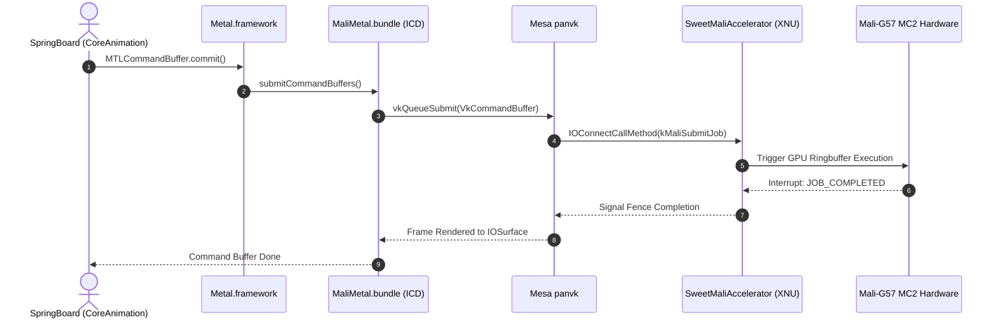

# MaliMetal: Metal-to-Vulkan Driver Architecture (Design Proposal)

> [!NOTE]
> **Status:** Architectural Design Specification & Work-in-Progress Research.
> This document details the planned two-tier driver architecture bridging Apple's `Metal.framework` to Mesa's `panvk` Vulkan 1.3 implementation for ARM Mali Valhall GPUs. Development of the userspace ICD proceeds in parallel with kernel-level GPU hardware domain bring-up.

## 1. Overview & Architectural Motivation

In the Apple ecosystem, visual elements and UI compositing (`RenderServer`, `backboardd`, `SpringBoard`) are rendered through Apple's graphics API: **Metal**.

On genuine Apple hardware, Metal interacts directly with proprietary Apple Silicon GPUs (A-series / M-series). On third-party ARM platforms, running hardware-accelerated iOS graphics requires an Installable Client Driver (ICD) capable of bridging Metal calls to the platform's native GPU capabilities.

**HelioDarwin proposes `MaliMetal`**: a two-tier graphics driver architecture bridging Apple's `Metal.framework` to **Vulkan 1.3** via Mesa's open-source `panvk` driver on ARM Mali-G57 MC2 hardware.

---

## 2. Prior Art & Lineage in the Darwin Ecosystem

The concept of running Apple's Metal API over Vulkan has an extensive and respected engineering history in the open-source community:

* **[darlinghq/darling#390](https://github.com/darlinghq/darling/issues/390)** (June 2018): First conceptual discussion on implementing Metal API over Vulkan for macOS userland under Linux.
* **[darlinghq/indium](https://github.com/darlinghq/indium)** & **Iridium** (2020–2023): The foundational open-source implementation of Metal on Vulkan 1.3, including `mtl2spv` (Apple Intermediate Representation / AIR LLVM bitcode to SPIR-V translation).
* **[darlinghq/darling-metal](https://github.com/darlinghq/darling-metal)**: ABI-compatible implementations of `Metal.framework`, `MetalKit`, and `MetalPerformanceShaders`.
* **[steelbrain/metal2vulkan](https://github.com/steelbrain/metal2vulkan)** & **Hi-Jiajun/metal-api-emulator**: Modern research in AIR-to-SPIR-V translation pipelines.
* **Apple Metal Shader Converter** & **MoltenVK**: Upstream tools demonstrating production-grade translation between Apple graphics IR and industry standards (DXIL, Vulkan).

`MaliMetal` adapts these foundational principles specifically to **native ARM Mali Valhall GPUs** driven by Mesa's `panvk`, operating as an Installable Client Driver loaded directly by Apple's stock `Metal.framework` via Darwin's IORegistry.

---

## 3. Architectural Stack

| Layer | Subsystem | Functionality & Role |
| :--- | :--- | :--- |
| **Compositing** | `SpringBoard` & `CoreAnimation` | Renders the iOS 16 UI using the Apple Metal pipeline |
| **Graphics API** | Apple `Metal.framework` | Provides the native `MTLDevice` endpoint for the OS |
| **Userspace ICD** | `MaliMetal.bundle` (`MaliMetalDevice`) | Translates Metal API calls and AIR/MSL shaders into Vulkan 1.3 |
| **Vulkan Driver** | Mesa `panvk` | Compiles SPIR-V shaders and emits native Mali Valhall machine code |
| **Kernel Driver** | `SweetMaliAccelerator` (XNU) | Sequences MFG MTCMOS power (SPM `0x10006308+`), maps MMIO, *will* own job rings |
| **Hardware** | ARM Mali-G57 MC2 (MT6789) | 2 Valhall cores; vendor product ID `0x9093`. Not yet powered/responding under XNU |

> **Reality check.** Rows marked *will* / *would* below are the design target, not
> working code. Today only the kernel power-on (being brought up) and a userspace CPU
> 2D compositor exist. There is no Vulkan/panvk, no AIR→SPIR-V, no GPU-accelerated draw.

---

## 3. How Metal Discovers and Loads the Driver

When an iOS framework calls `MTLCreateSystemDefaultDevice()`:
1. `Metal.framework` queries the Darwin kernel's IORegistry for any service of class `IOAccelerator`.
2. The kernel's `SweetMaliAccelerator` service answers with its properties. The real
   hardware ID (`0x13b5`/`0x9093`, read from the vendor Mali driver's sysfs) is only
   published once the GPU answers on the bus; until then `device-id` is `0`:
   ```text
   MetalPluginName      = "MaliMetal"
   MetalPluginClassName = "MaliMetalDevice"
   vendor-id            = 0x13b5 (ARM Ltd.)
   device-id            = 0x9093 (Mali-G57 Valhall r0p1) when live, else 0 (offline-stub)
   gpu-core-count       = 2
   ```
3. `Metal.framework` locates and dynamically loads `/System/Library/Extensions/MaliMetal.bundle` via `CFBundle`.
4. It instantiates the principal class `MaliMetalDevice`, which conforms to the internal `<MTLDeviceSPI>` protocol.
5. Today the bundle satisfies `Metal.framework` during boot and composites UI on the CPU
   (`MaliMetalVulkan.c` is a software 2D rasterizer). The GPU/Vulkan path below is the
   design target, **not** what runs today.

---

## 4. Subsystem Mapping: Metal to Vulkan

| Metal Primitive | Vulkan Equivalent | Implementation Details |
| :--- | :--- | :--- |
| `MTLDevice` | `VkDevice` / `VkPhysicalDevice` | Wraps Mali-G57 physical device initialized via `panvk`. |
| `MTLCommandQueue` | `VkQueue` + `VkCommandPool` | Allocates GPU submission queues for graphics and compute. |
| `MTLCommandBuffer` | `VkCommandBuffer` | Records state changes and pipeline bindings. |
| `MTLRenderCommandEncoder`| `vkCmdBeginRenderPass` / `vkCmdDraw` | Maps draw calls, depth/stencil state, and scissor rects. |
| `MTLBuffer` | `VkBuffer` + `VkDeviceMemory` | Backed by contiguous physical pages allocated by the kernel. |
| `MTLTexture` | `VkImage` + `VkImageView` | Zero-copy mapping to `IOSurface` memory buffers. |
| `MTLLibrary` | SPIR-V Modules | Compiles MSL or AIR bytecode to Vulkan SPIR-V. |

---

## 5. Graphics Execution Sequence



---

## 5. Shader Translation Pipeline (AIR to SPIR-V)

Apple's Metal compiler produces shaders in **Apple Intermediate Representation (AIR)**, which is serialized LLVM 14 bitcode with custom Apple intrinsics (`air.interpolate`, `air.sample_texture`).

The shader translation engine in `MaliMetal` processes shaders in two paths:
1. **Source Translation (Metal Shading Language → SPIR-V)**: For shaders compiled from runtime strings, MSL syntax is parsed into high-level AST and emitted as SPIR-V using a specialized Clang frontend.
2. **Binary Translation (AIR Bitcode → SPIR-V)**: For precompiled `.metallib` libraries shipped inside iOS system frameworks:
   * The AIR bitcode is parsed via LLVM IR libraries.
   * Apple-specific intrinsics are mapped to standard Vulkan GLSL/SPIR-V capabilities.
   * Emitted SPIR-V is passed directly to `vkCreateShaderModule()`, where Mesa's `panvk` compiler generates native Mali Valhall machine code.
