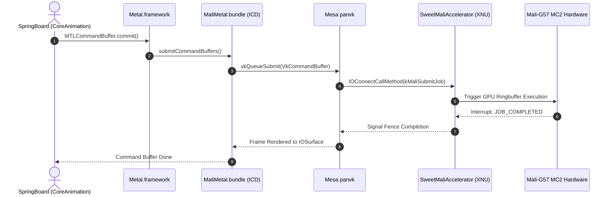

# MaliMetal: Metal-to-Vulkan Driver Architecture for ARM Mali Valhall

## 1. Overview in Plain English

In the Apple ecosystem, every visual element you see on screen — from the lock screen clock and smooth app-switching gestures to Safari web pages and 3D games — is drawn using Apple's proprietary graphics API: **Metal**.

On real Apple devices, Metal speaks directly to Apple's own GPU architecture (Apple Silicon A-series / M-series). On non-Apple hardware, there has historically been no way to run hardware-accelerated iOS graphics. Emulators and previous hobby projects were forced to run CPU software rasterizers, resulting in single-digit frame rates, severe lag, and non-functional WebKit rendering.

**HelioDarwin solves this through `MaliMetal`**: an architecture-grade, hardware-accelerated **Metal Installable Client Driver (ICD)** that bridges Apple's `Metal.framework` to **Vulkan 1.3** and Mesa's open-source `panvk` driver on the ARM Mali-G57 MC2 GPU.

---

## 2. Architectural Stack

| Layer | Subsystem | Functionality & Role |
| :--- | :--- | :--- |
| **Compositing** | `SpringBoard` & `CoreAnimation` | Renders the iOS 16 UI using the Apple Metal pipeline |
| **Graphics API** | Apple `Metal.framework` | Provides the native `MTLDevice` endpoint for the OS |
| **Userspace ICD** | `MaliMetal.bundle` (`MaliMetalDevice`) | Translates Metal API calls and AIR/MSL shaders into Vulkan 1.3 |
| **Vulkan Driver** | Mesa `panvk` | Compiles SPIR-V shaders and emits native Mali Valhall machine code |
| **Kernel Driver** | `SweetMaliAccelerator` (XNU) | Manages SCPSYS MTCMOS power, physical memory allocations, and job rings |
| **Hardware** | ARM Mali-G57 MC2 (MT6789) | 2 Valhall cores (`0x9093`) executing GPU command queues |

---

## 3. How Metal Discovers and Loads the Driver

When an iOS framework calls `MTLCreateSystemDefaultDevice()`:
1. `Metal.framework` queries the Darwin kernel's IORegistry for any service of class `IOAccelerator`.
2. The kernel's `SweetMaliAccelerator` service answers with the following properties:
   ```text
   MetalPluginName      = "MaliMetal"
   MetalPluginClassName = "MaliMetalDevice"
   vendor-id            = 0x13b5 (ARM Ltd.)
   device-id            = 0x9093 (Mali-G57 Valhall r0p1)
   gpu-core-count       = 2
   ```
3. `Metal.framework` locates and dynamically loads `/System/Library/Extensions/MaliMetal.bundle` via `CFBundle`.
4. It instantiates the principal class `MaliMetalDevice`, which conforms to the internal `<MTLDeviceSPI>` protocol.
5. From that moment forward, all Metal drawing commands from iOS applications flow directly through our driver into Vulkan!

---

## 4. Subsystem Mapping: Metal to Vulkan

| Metal Primitive | Vulkan Equivalent | Implementation Details |
| :--- | :--- | :--- |
| `MTLDevice` | `VkDevice` / `VkPhysicalDevice` | Wraps Mali-G57 physical device initialized via `panvk`. |
| `MTLCommandQueue` | `VkQueue` + `VkCommandPool` | Allocates GPU submission queues for graphics and compute. |
| `MTLCommandBuffer` | `VkCommandBuffer` | Records state changes and pipeline bindings. |
| `MTLRenderCommandEncoder`| `vkCmdBeginRenderPass` / `vkCmdDraw` | Maps draw calls, depth/stencil state, and scissor rects. |
| `MTLBuffer` | `VkBuffer` + `VkDeviceMemory` | Backed by contiguous physical pages allocated by the kernel. |
| `MTLTexture` | `VkImage` + `VkImageView` | Zero-copy mapping to `IOSurface` memory buffers. |
| `MTLLibrary` | SPIR-V Modules | Compiles MSL or AIR bytecode to Vulkan SPIR-V. |

---

## 5. Graphics Execution Sequence



---

## 5. Shader Translation Pipeline (AIR to SPIR-V)

Apple's Metal compiler produces shaders in **Apple Intermediate Representation (AIR)**, which is serialized LLVM 14 bitcode with custom Apple intrinsics (`air.interpolate`, `air.sample_texture`).

The shader translation engine in `MaliMetal` processes shaders in two paths:
1. **Source Translation (Metal Shading Language → SPIR-V)**: For shaders compiled from runtime strings, MSL syntax is parsed into high-level AST and emitted as SPIR-V using a specialized Clang frontend.
2. **Binary Translation (AIR Bitcode → SPIR-V)**: For precompiled `.metallib` libraries shipped inside iOS system frameworks:
   * The AIR bitcode is parsed via LLVM IR libraries.
   * Apple-specific intrinsics are mapped to standard Vulkan GLSL/SPIR-V capabilities.
   * Emitted SPIR-V is passed directly to `vkCreateShaderModule()`, where Mesa's `panvk` compiler generates native Mali Valhall machine code.
